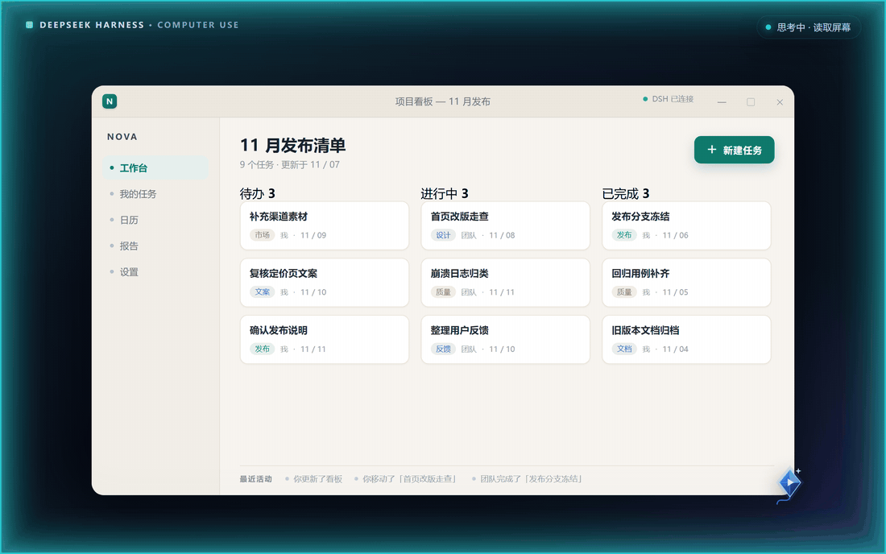
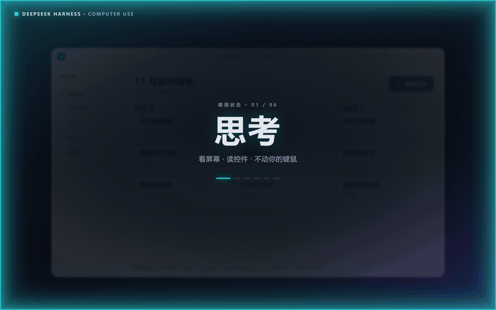
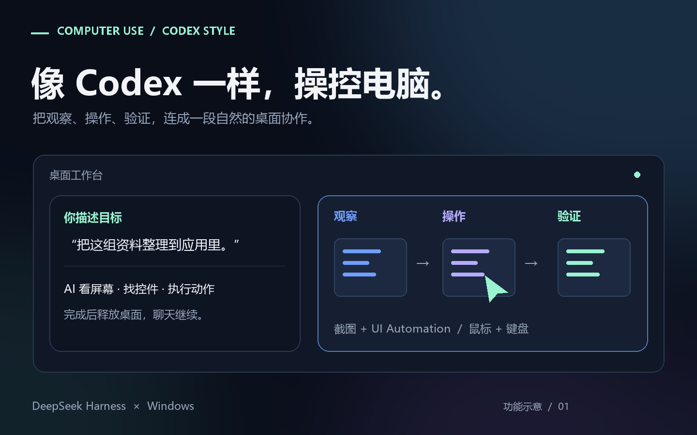
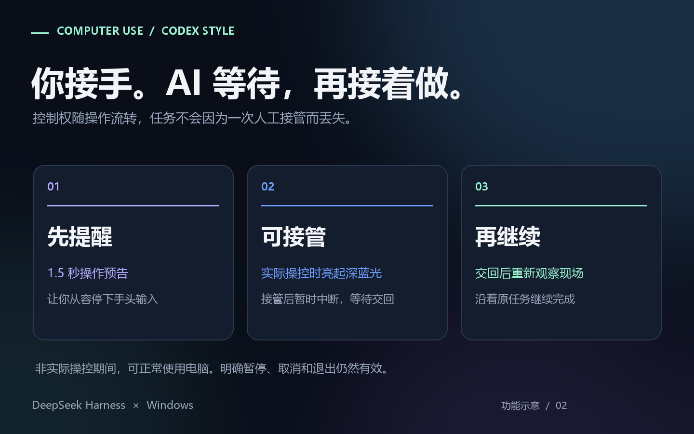
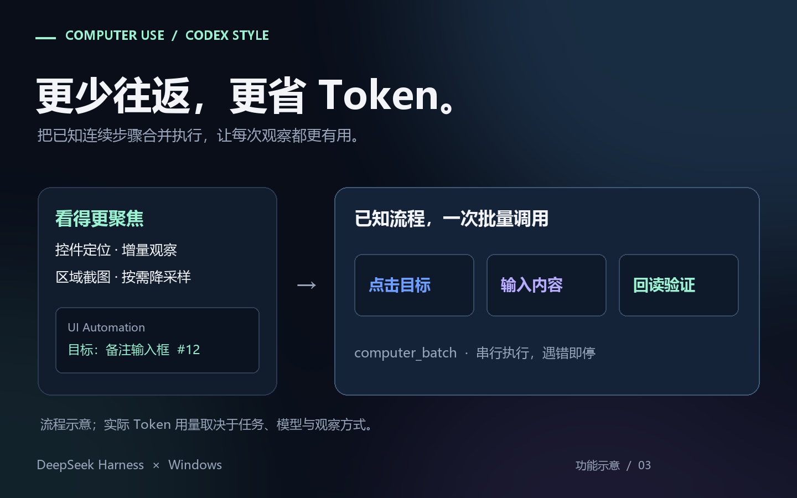

# Codex-style Computer Use

[](https://dshopen.org/zh/plugins/dsh-codex-style-computer-use/)

**The most precise way to drive Windows from DeepSeek Harness — and the cheapest per task.**

Describe the goal. Your agent reads exact control identities, acts through the controls themselves, verifies the result — and finishes a known sequence in one model round trip instead of ten.

English | [中文](README.zh.md) | [Français](README.fr.md) | [Deutsch](README.de.md) | [Español](README.es.md) | [Português](README.pt.md) | [العربية](README.ar.md) | [Русский](README.ru.md) | [فارسی](README.fa.md) · [Install](#install-and-update-in-dsh-market) · [Changelog](CHANGELOG.md) · [2.0.0 changes](docs/RELEASE-2.0.0.md)







## Why it is the precise one

- **Identity, not guesswork.** UI Automation exposes the real control tree with exact `AutomationId`s, and actions can drive a control through its own UI Automation patterns instead of clicking coordinates.
- **Marks are checked, not trusted.** By default, a numbered mark is validated against window identity and sampled pixels before any input is dispatched, so a stale mark is refused rather than clicked at the wrong place. When an animated neighbour keeps invalidating the pixel signature, `uiaOnly` pins identity to the window handle and geometry while the dispatch-time occlusion check still applies.
- **Queries stay bounded.** UIA queries default to depth 6, 120 nodes and a 1200 ms soft budget; a query deeper than 6 or larger than 300 nodes requires a measured `anchor`, so a query cannot quietly sweep the wrong region.
- **When the app hides it, read it.** `computer_ocr` returns lines and per-word boxes in absolute screen pixels, so zero-UIA applications can be located by name.

## Why it costs less

- **One round trip for a known sequence.** One `computer_batch` call runs a list of actions serially, stops at the first failure, and costs one model round trip instead of one per action.
- **Only the delta comes back.** Pass the previous observation ID as `since` and receive additions, changes, removals and ordering — not the whole tree again.
- **Compact receipts by default in 2.0.0.** Post-action text normally adds at most 6 KiB to the action receipt; `feedback: full` is still there when detail matters more.
- **Evidence stays out of the conversation.** Complete point evidence can live in a bounded local cache (4 MiB memory, 32 MiB disk, 64 records, 24-hour expiry) and be pulled on demand.
- **Local work stays local.** UI Automation, screen OCR and pixel checks run in the prebuilt native worker — no extra vision bill per step.

## Built for a desktop you still use

- **It waits for you.** A 1-second notice before input (0.1 second within a rolling 3-minute window) hands the desktop back immediately; after you finish, the agent re-observes and continues the original task.
- **The brake reaches the model.** `Ctrl+Esc` pauses, `Ctrl+Alt+R` resumes, `Ctrl+Alt+Q` exits, and a stop is pushed into the running session. Approvals stay on by default and password fields are refused by default.
- **It reports what it cannot do.** The Windows secure desktop (UAC prompt or lock screen) is detected, reported and resumed after — not blind-retried.





The illustrations above show the interaction model introduced in 1.3.0; the 2.0.0 kite pointer, bounded queries and compact receipts are described above. Actual token use depends on the task, model and observation strategy. Approvals remain enabled by default; explicit pause, cancellation and exit remain authoritative.

**Ready to install.** 19 desktop tools, with native helpers included. No SDK or install-time compilation. Requires Windows, Node.js ≥ 22 and the .NET Framework 4.x included with Windows. An independent community plugin; Codex describes the interaction style.

## New in 2.0.0

- **Compact receipts by default** — post-action text normally adds at most 6 KiB to the action receipt; `feedback: full` and `feedback: none` are explicit alternatives.
- **Bounded, anchored UIA queries** — depth 6, 120 nodes and a 1200 ms soft budget by default; queries deeper than 6 or larger than 300 nodes need a measured `anchor`.
- **Evidence on demand** — 4 MiB memory + 32 MiB disk, 64 records, 24-hour expiry; a disk failure falls back to bounded memory.
- **Adaptive preparation notice** — 1 second initially, 0.1 second within a rolling 3-minute window; the tilted kite marks the agent's click point.
- **Hardened input path** — guarded window-management chords, worker backpressure/recovery, stale-target checks and cancellation cleanup.

<details>
<summary>Current release and compatibility</summary>

**2.0.0** is the new major release, initially distributed on npm `next` while the 24-hour release gate runs. See [2.0.0 changes and migration](docs/RELEASE-2.0.0.md). Check registry tags for current stable availability.

Version 1.3.1 reads text from the screen by name, notices the Windows secure desktop and resumes on its own, and keeps every colour on the same DPI-derived edge rail with a visible breathing floor. Version 1.3.0 releases desktop control when work ends while the chat continues.

Earlier fixes: [1.2.3 approval attribution](docs/RELEASE-1.2.3.md) · [1.2.1 native attention](docs/RELEASE-1.2.1.md) · [standalone host patch](docs/RELEASE-1.2.2.md).

</details>

## What it does

Version 2.0.0 also uses a compact blue kite pointer during AI operation and scene hold. Its tilted tip marks the click point, with small text/resize symbols inside the kite. A breathing kite means the page and pointer position should stay in place; free mode restores the application's normal cursor. The user's Windows cursor theme is preserved.

Version 2.0.0 bounds UIA traversal and defaults to compact post-action text. Existing image feedback remains available; `feedback: compact|full|none` controls detail, and click `verificationRegion: "x,y,w,h"` names the expected effect area independently of the input point. Compact text normally adds at most 6 KiB to the original action receipt. Complete point evidence can be retained in a bounded, expiring local cache and retrieved on demand. Disk failure falls back to bounded memory; if no retrievable snapshot can be retained, the current evidence is returned inline in full, outside that compact budget, without another observation or input.

Filtered UIA queries require `hwnd`. Defaults are depth 6, 120 nodes and a 1200 ms soft budget. A query deeper than 6 or larger than 300 nodes requires a measured `anchor:"x,y"` in that window; an exact `id` does not bypass this rule. A provider call can exceed the soft budget, and partial results cannot establish absence or uniqueness. After a window-management shortcut, inspect `computer_state {windows:true}`, activate the intended window successfully, then observe it before more keyboard input.

- **Observe** — window list, screenshots (region / JPEG / PNG / downscaled), a Set-of-Marks map of
  clickable elements, and the UI Automation tree with exact `AutomationId`s.
- **Act** — click, move, drag, scroll, select a text range, type, press keys, and drive controls
  through their own UI Automation patterns instead of blind coordinates.
- **Batch** — one `computer_batch` call runs a list of actions serially and stops at the first
  failure, so a known sequence costs one model round trip instead of ten.
- **Ask** — `computer_ask` raises a question on the same chat card DSH uses for `ask_user_question`,
  with no countdown.
- **A human brake that reaches the model** — a stop is pushed into the running session, so the agent
  learns it was interrupted instead of discovering it on the next turn.

The tools observe the desktop rather than crawl user documents. The plugin manages native helpers in
`%LOCALAPPDATA%\dsh-computer-use\worker\`, and audit logs, screenshots and its own bounded
`observation-cache` under `$DSH_HOME/data/computer-use/`. `computer_ctrl {action:"clear_cache"}` clears
this Agent's observation cache; it does not delete screenshots, attachments or user documents.

## Install and update in dsh-market

Search **computer-use** or **Codex-style** in the market. Look for repository **ltmroberthk915/dsh-computer-use** and npm package **dsh-codex-style-computer-use** (maintainer: **ltmroberthk**), then click **Install**. Use **Update** or **Update all** for stable-channel updates. Both native helpers are included; no PowerShell 7 or build permission is needed.

Alternatively, enter **`dsh-codex-style-computer-use`** in **Settings → Plugins → Add plugin** for the current stable channel, or **`dsh-codex-style-computer-use@2.0.0`** for the version described here. Enter the npm package spec directly. Your host may apply a waiting period to fresh versions; follow its indication. A newly added bundle can load live on supported hosts; check that its tools and skill appear. Restart from the tray when replacing a loaded version, when the client remains stale, or when DSH reports **restart-required**.

### Releases less than 24 hours old

The default non-strict pnpm 11.7.0 configuration automatically records a single-version exception and installs. A successful install on one machine does not establish that another machine permits fresh versions.

With `minimumReleaseAgeStrict: true` (or a host policy that enables strict release-age checks), and no applicable exception, a version below the configured age is rejected before plugin code runs. The bare name, an exact `@1.2.0` pin, and the npm tarball URL were all verified to fail with `ERR_PNPM_NO_MATURE_MATCHING_VERSION` under that policy. Explicitly setting `minimumReleaseAge: 1440` also enables strict behavior in pnpm 11.7.0 unless `minimumReleaseAgeStrict` is separately set to false. Restarting DSH, installing PowerShell, or retrying the same command does not fix a strict-policy refusal. The official desktop bridge does not accept extra pnpm flags.

If a strict policy blocks installation, wait until the version meets the configured age to install without changing policy. Version 1.2.0 was published at `2026-10-03T03:50:11.586Z`; it meets a 24-hour cutoff after **2026-10-04 03:50:12 UTC** (11:50:12 in China). A longer custom cutoff or a lagging registry mirror can delay availability further. Default non-strict users do not need to wait or edit configuration for this package.

If you explicitly choose to install earlier, merge this single-version exception into the target profile's existing `pnpm-workspace.yaml`, then retry the market install. Preserve other entries; do not disable the global age policy:

```yaml
minimumReleaseAgeExclude:
  - dsh-codex-style-computer-use@1.2.0
```

The default desktop path is `%USERPROFILE%\.dsh\profiles\desktop\pnpm-workspace.yaml`; use the actual directory if `DSH_HOME` is customized. Remove this one exception after the version matures if desired.

The earlier documentation and publisher-check corrections did not change the 1.2.0 runtime and needed no reinstall. The native attention fix in **1.2.1** does require an update. Re-adding the same source can produce a host `ambiguous-install` error on some installation paths; reinstalling 1.2.0 will not apply the 1.2.1 fix.

**Migrating an older Git/tarball installation from this repository:** remove the old **dsh-computer-use** entry in the market, then install **dsh-codex-style-computer-use**. The unscoped npm name `dsh-computer-use` belongs to a different repository; do not install it as an upgrade of this plugin. A Git installation cannot switch its dependency identity just by fetching a new commit. After this one-time UI migration, use normal market updates. Existing `computer_*` tool names and the `computer-use` settings namespace are retained.

**Preserve your saved configuration too:** back up the profile's `cordis.patch.yml`, then change only `name: dsh-computer-use` on an override with `id: computer-use` to `name: dsh-codex-style-computer-use`. Keep its entire `config` and `disabled` fields. Retaining the settings namespace alone is insufficient: a name mismatch makes DSH skip even `read-only`, `dryRun`, and disabled-state overrides. Do not replace other plugins or a shared home patch globally. The repository's `scripts/migrate-profile.mjs` previews by default; `--apply` creates a backup and replaces the file atomically, refusing concurrent edits.

Alternatively, download the [configuration migration utility](https://github.com/ltmroberthk915/dsh-computer-use/releases/download/v1.2.0/computer-use-profile-migration.zip), extract it and double-click `migrate-profile.cmd`. It locates the installed official Desktop app and uses Windows PowerShell 5.1 plus DSH's bundled Node to repair the default desktop profile. It stops if the new bundle is absent or the old bundle is still selected. It does not change release-age policy. For another profile, run `migrate-profile.ps1 -ProfileDirectory <absolute-directory>` to preview, then add `-Apply` when ready.

The GitHub Release also includes `dsh-computer-use.tgz` for offline/manual installation; registry installation is the default for market updates.

CLI users (web profile):

```sh
dsh plugin --profile web add dsh-codex-style-computer-use
```

Desktop diagnostics must use the **CLI bundled with the official Desktop app**:

```powershell
$CuDshInstall = Join-Path $env:LOCALAPPDATA 'Programs\DeepSeek Harness'
& "$CuDshInstall\resources\runtime\cli\bin\dsh.cmd" plugin --profile desktop why dsh-codex-style-computer-use
```

For a custom installation, set `$CuDshInstall` to the directory in the Desktop shortcut's target. An older global npm `dsh` can reject the desktop profile. Do not add `resources/runtime/bin` to the global PATH or install a separate pnpm for this task. Prefer the plugin UI for installation.

## The bundled skill

The driving tools stay locked until the session produces a receipt phrase that exists only inside
`skills/computer-use/SKILL.md`. That is deliberate — it is the strongest honest version of "read the
manual before driving", because no tool layer can see whether a model read a document.

The plugin registers the bundled skill through `ctx.skills.register()` when available. If that service is absent, `computer_use_activate` returns the same manual, its absolute source path and the scoped tool list. The receipt and all existing approval/brake checks still apply.

## Shared input in 1.2.0-rc.2

This pre-release introduces immediate human takeover, automatic waiting after 2 seconds of continued input, and continuation after 3 quiet seconds. Waiting happens locally without model polling. Interrupted writes require a fresh readback and are never blindly replayed. Host cancellation releases accepted automation-owned input without creating a new persistent pause. Existing DSH Pet/main-window and original-topmost handling is retained.

The configured GLM 5.3 Max, GLM 5.3 Flash and DeepSeek Flash routes passed a controlled continuation-protocol test. Native input and physical hotkeys were verified separately; this is not a general desktop or vision benchmark. See [release verification](docs/RELEASE-1.2.0-rc.2.md) for scope.

## On-demand controls in 1.1

- **Per-Agent tools:** idle Agents see `computer_use_activate`, `computer_ctrl` and `computer_ask`. A successful computer-use skill load, receipt or activation exposes the 19 desktop tools plus the activation entry to that Agent. Other Agents and children activate independently. Native calls and Node `run_code` are supported. Activation does not start control or release a human brake.
- **Observed UIA targets:** a scoped name/id query returns an opaque target handle. Use it for pattern actions; opt-in `rebind:true` allows unique identity or semantic recovery after replacement in the same window. Changed context, ambiguity and incomplete scans refuse. Broad queries skip recovery handles unless `targets:true`; creating witnesses for a large list costs extra native work.
- **Incremental observations:** pass the previous observation ID as `since` with the same query. Deltas preserve additions, changes, removals and ordering. Snapshots are isolated by Agent, with at most 64 indexed observations and 4 MiB of retained JSON per store. `snapshot` retrieves a retained historical result; `offset` and `limit` page its arrays. Missing bases, changed scope, incomplete evidence or a larger delta fall back to full output.

See [the detailed protocol](skills/computer-use/references/progressive-control.md) for cache limits and recovery boundaries. UIA snapshots preserve provider-returned fields within existing provider limits; historical retrieval is not fresh outcome verification.

## Tools

| Group | Tools |
|---|---|
| Activate | `computer_use_activate` |
| Observe | `computer_state` `computer_shot` `computer_ocr` `computer_marks` `computer_uia` |
| Act | `computer_click` `computer_move` `computer_drag` `computer_scroll` `computer_select` `computer_key` `computer_type` `computer_uia_act` `computer_window` `computer_clip` |
| Flow | `computer_wait` `computer_batch` |
| Meta | `computer_ask` `computer_ctrl` |

`computer_marks` returns numbered marks for the elements it found on screen; `computer_marks {shot:true}` also saves an annotated image. `computer_shot` returns a plain screenshot and, on image-capable routes, a native image attachment. A mark is a snapshot ID: it is validated against window
identity and sampled pixels before any input is dispatched, so a stale mark is refused rather than
clicked at the wrong place.

## Approval modes

For a host that reports a disabled-prompt automatic refusal as “the user rejected tool”, see the [DSH approval attribution patch and regression test](docs/APPROVAL-ATTRIBUTION.md).

`automationMode` is set in the plugin's settings and defaults to `standard`:

| Mode | Observation | Actuation |
|---|---|---|
| `read-only` | allowed | denied |
| `standard` | allowed | every action asks through the host's approval card |
| `autonomous` | allowed | allowed, high-risk operations still ask |
| `unrestricted` | allowed | allowed (worker failsafe and rate limit still apply) |

High-risk operations (closing a window, `alt+f4`, `win+r`, and the like) ask in every mode. Password
fields are detected through UI Automation's `IsPassword` and refused by default.

## Safety model

- **Shared input** — ordinary user activity is allowed while the agent is thinking, observing or preparing. During actual actuation, typing, scrolling and buttons yield immediately; pointer movement has a 16-pixel displacement tolerance. Continued input or a held key/button for 2 seconds enters automatic waiting. After release and 3 quiet seconds, the agent must inspect the current target and continue the original task, without blindly replaying partial writes. A gentle pale-yellow edge gradient shows human ownership.
- **Release by desktop block, not by every call** — one cycle covers one continuous desktop block, not the whole task. When you leave that block for publish, upload, install, build, test, network, a file write, analysis or chat, call `computer_ctrl {action:"release"}` first. Keep the cycle only while the next call is still in the same block, including one quick readback you type straight back. An artifact in hand (token, clipboard text, value, path, screenshot) is a signal that the block may be ending, not an automatic release point. Do not hold "in case I need the desktop later"; reacquiring the lease is cheap, while a lit border and an exclusive lease during a long command are not. `hold` is only for position-sensitive readback inside the block, never across a build/publish/upload or long command; `free` then `release`. A deterministic **100-second leave backstop** (`leaveDesktopGraceMs`; 0 disables) releases the lease if no `computer_*` call starts within the grace after a non-desktop tool; it is owner-scoped, cancelled by an actual computer start, never releases a newer cycle, and `hold` does not extend it.
- **Manual pause** — only physical `Ctrl+Esc` raises a persistent input brake; `Ctrl+Alt+R` resumes. Ordinary Esc, typing, scrolling, pointer distance/frequency and the screen corner do not create this pause. Explicit question/diagnostic holds remain separate.
- **Exit** — `Ctrl+Alt+Q` ends the session: the overlay goes away, its listeners are torn down, and
  further actuation is refused until a later turn opens a new one.
- **The brake is a fact about the machine, not one process** — the engaged state is persisted, and
  every worker adopts it, including one started later from a shell.
- **The handback wait is bounded** — if a handoff makes no progress for 60 s, `waitForHuman` ends the
  wait with `HANDOFF_WAIT_TIMEOUT` and tells the agent to re-observe (retryable, no input replay).
  Every real input event re-arms that quiet timer, so a human who keeps using the machine is never
  cut off; a `ping` recovery probe runs every 5 s to recover a lost `handoff:idle` event. A genuinely
  held key/button is different: it gets five windows (about 5 minutes by default) and then ends with
  `HANDOFF_HELD_TIMEOUT`, so a stale `heldCount` cannot wait out the cooperative 3,600,000 ms
  deadline. A host approval card happens before `waitForHuman` and is bounded by the host's own
  approval wait, not by this local limit.
- **Audit** — every actuation is appended to `$DSH_HOME/data/computer-use/audit.jsonl` with argument
  sanitisation.
- **Kill switch for the plugin itself** — `DSH_COMPUTER_USE_KILL=1` makes the plugin refuse to start;
  `dryRun: true` simulates actuations and only logs them.

## Configuration

| Key | Default | Meaning |
|---|---:|---|
| `automationMode` | `standard` | approval mode (above) |
| `progressiveTools` | `true` | per-Agent activation; `false` exposes the 19 desktop tools globally |
| `actionFeedback` | `true` | automatically observe after direct actions and batches |
| `actionFeedbackDetail` | `compact` | `compact`, `full` or `none`; a call's `feedback` overrides this default; uncached evidence falls back to full inline output |
| `dryRun` | `false` | simulate actuations, log only |
| `maxActionsPerMinute` | `60` | core-level actuation rate limit |
| `leaveDesktopGraceMs` | `100000` | grace after leaving the desktop for another tool; automatic lease expiry, `0` disables |
| `annotateMarks` | `true` | draw Set-of-Marks boxes on screenshots |
| `workerExe` | `""` | explicit worker path; empty = autodiscover or compile |
| `snapshotDir` | `""` | screenshot directory; empty = `$DSH_HOME/data/computer-use/shots` |

**When the desktop host does not render the plugin settings card:** set `config` directly on the
`- id: computer-use` row in the target profile's `cordis.patch.yml` (for example
`automationMode: autonomous`, `dryRun: false`), preserving existing keys; restart the host. If a CLI
install did not reconcile into `dsh.profile.bundles`, the same `- insert:` row can mount it manually
(issue #3).

## MCP server

`mcp/` is a zero-dependency MCP stdio server over the same core, for clients that speak MCP rather
than Cordis:

```sh
# published package (2.0.1 and later) — no checkout needed
npx -y dsh-codex-style-computer-use

# from a checkout
node mcp/src/index.js
```

The embedded server reports the version of this root package. It starts with observation only.
The launching host may set `DSH_CU_ALLOW_INPUT=1` when it owns authorization for desktop actions;
MCP tool calls cannot enable input. The compatibility tool `cu_approve` only reports this rule and
never grants consent. DSH's `automationMode` policy belongs to the Cordis adapter and is not an
MCP approval service. `DSH_CU_DRY_RUN=1` simulates input that the host has already enabled.

Both adapters use the same key-command grammar, batch failure and continuation rules, and image
coordinate mapping. MCP returns structured capture metadata and one latest PNG/JPEG image, without
serializing image bytes into JSON text. `cu_hold` / `cu_free` reserve or release the scene between
actions; `cu_release` ends the desktop cycle. `cu_drag` accepts `expectCursor` and `hwnd` checks.
MCP exposes a smaller tool surface; DSH-specific human-question and host-lifecycle integration are
provided by the Cordis adapter.

## Development

Publisher release checks use npm's official registry by default. If that origin is unreachable on your network, `CU_REGISTRY` selects an explicit mirror for the read-only `check` command; the JSON result includes `registry` and `authoritative`. Example in PowerShell (this changes only the current shell):

```powershell
$env:CU_REGISTRY = 'https://registry.npmmirror.com'
node scripts/release-channel.mjs check 1.2.0
Remove-Item Env:CU_REGISTRY
```

Exit code `0` means the version has passed the 24-hour publisher check, `2` means it is still cooling, and `1` means the check failed. A network failure does not establish that a package is unpublished, and mirrors can lag. `promote` always rechecks and writes `https://registry.npmjs.org`, ignoring `CU_REGISTRY`; it needs access to that origin, using npm's proxy configuration when necessary. This publisher tool is not part of end-user installation. See [the release procedure](docs/RELEASE-1.2.0.md).

The repository ships the guard suite that protects the invariants above — the cycle lifetime, the
ask/brake protocol, the operation classification, the skill gate, and the bundled-skill wiring:

```sh
pwsh -NoProfile -ExecutionPolicy Bypass -File build/run-guards.ps1   # all guards
node build/verify-tools-schema.mjs                                   # tool-schema load guard
```

The tool definitions are compiled through the real `@deepseek-ai/dsh-tools` DSL, so a schema mistake
fails here instead of taking the host's plugin tree down on restart. Some guards compile the native
worker and are Windows-only.

Publishing runs `npm run verify:package` first: it checks the packed identity, the prebuilt helper
hashes and every `bin` entry (target present, node shebang). It is deliberately not a publish hook —
the package ships no lifecycle scripts — so run it yourself immediately before `npm publish`.

## License

MIT — see [LICENSE](LICENSE).
