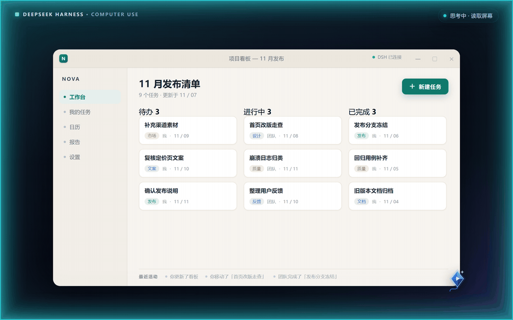
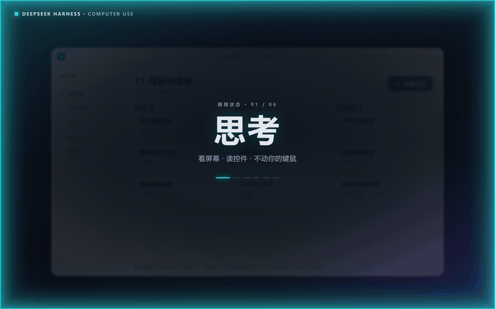

# Codex 风格 Computer Use

[](https://dshopen.org/zh/plugins/dsh-codex-style-computer-use/)

**全市场最精准的 Windows 桌面操控，也是单个任务成本最低的。**

你描述目标，AI 读准控件身份、按真实控件执行、回读结果——一段已知流程一轮模型往返就跑完，而不是每个动作各花一轮。

[English](README.md) | 中文 | [Français](README.fr.md) | [Deutsch](README.de.md) | [Español](README.es.md) | [Português](README.pt.md) | [العربية](README.ar.md) | [Русский](README.ru.md) | [فارسی](README.fa.md) · [安装](#在-dsh-market-安装和更新) · [版本记录](CHANGELOG.md) · [2.0.0 变更](docs/RELEASE-2.0.0.md)






## 为什么它更准

- **认身份，不猜坐标。** UI Automation 给出真实控件树与精确 `AutomationId`，动作可以走控件自身的 UI Automation 模式，而不是盲点坐标。
- **标记先校验，再执行。** 默认情况下，编号标记在派发输入前按窗口身份与采样像素校验，过期标记会被拒绝，不会点错位置。动画邻居导致像素签名失效时，`uiaOnly` 用窗口句柄与几何固定身份，派发时的遮挡检查仍然生效。
- **查询有边界。** UIA 查询默认深度 6、120 节点、1200 毫秒软预算；深度超过 6 或节点超过 300 时必须提供已测量的 `anchor`，不会悄悄扫错区域。
- **看不见就读字。** `computer_ocr` 返回绝对屏幕像素的行与词框，零 UIA 应用也能按名字定位。

## 为什么它更省

- **一段已知流程只花一轮往返。** 一次 `computer_batch` 串行执行整串动作、遇错即停，只花一轮模型往返，而不是每个动作各花一轮。
- **只回增量。** 把上一次观察 ID 作为 `since` 传回，只拿到新增、变化、删除与顺序，而不是整棵树重发。
- **2.0.0 默认精简回执。** 动作后的文字回执通常最多再加 6 KiB；需要细节时仍可用 `feedback: full`。
- **证据不进对话。** 完整点查证据可留在有界本地缓存（内存 4 MiB、磁盘 32 MiB、64 条、24 小时过期），按需读取。
- **本地的事留在本地。** UIA、屏幕 OCR 与像素校验都在预置原生 worker 里完成，不额外产生每一步的视觉账单。

## 它不会抢走你的桌面

- **会等你。** 操作前 1 秒提示（3 分钟内再次操作 0.1 秒）后即时交出桌面；你操作完，AI 重新观察并续接原任务。
- **刹车能传进模型。** `Ctrl+Esc` 暂停、`Ctrl+Alt+R` 恢复、`Ctrl+Alt+Q` 退出，停止事件被推入正在运行的会话。默认保留操作审批，密码框默认拒绝。
- **做不到的会说出来。** 检测到 Windows 安全桌面（UAC 或锁屏）会报告并在结束后自动续接，而不是盲目重试。


上图为 1.3.0 引入的交互模型；2.0.0 的风筝光标、有界查询与精简回执见上。实际 Token 用量取决于任务、模型和观察方式。默认保留操作审批；明确暂停、取消和退出始终有效。

**安装即用。** 19 个桌面工具，原生组件随包提供，无需 SDK 或安装时编译。支持 Windows、Node.js ≥ 22 和系统自带的 .NET Framework 4.x。独立社区插件；Codex 用于说明交互风格。

## 2.0.0 新特性

- **默认精简回执**——动作后的文字回执通常最多再加 6 KiB；需要细节可用 `feedback: full`，不需要可用 `feedback: none`。
- **有界、带锚点的 UIA 查询**——默认深度 6、120 节点、1200 毫秒软预算；深度超过 6 或节点超过 300 的查询必须提供已测量的 `anchor`。
- **证据按需读取**——内存 4 MiB + 磁盘 32 MiB、64 条记录、24 小时过期；磁盘失败回退到有界内存。
- **自适应操作预告**——首次 1 秒，3 分钟滚动窗口内再次操作 0.1 秒；倾斜的风筝标记点击点。
- **加固的输入路径**——窗口管理快捷键守卫、worker 背压/恢复、过期目标检查与取消清理。

<details>
<summary>当前版本与兼容性</summary>

**2.0.0** 为本次大版本，先发布至 npm `next`，通过仓库规定的 24 小时成熟期后再升稳定频道。详见 [2.0.0 变更与迁移](docs/RELEASE-2.0.0.md)，稳定版以 registry 标签为准。

1.3.1 可直接从屏幕读字定位控件，察觉 Windows 安全桌面并在其结束后自动续接；所有颜色共用同一条按 DPI 换算的边缘光环，呼吸谷值保持可见。1.3.0 起工具用完可主动释放，聊天继续；正常收尾自动退出。

历史兼容修复：[1.2.3 审批归因](docs/RELEASE-1.2.3.md) · [1.2.1 原生提醒](docs/RELEASE-1.2.1.md) · [独立宿主补丁](docs/RELEASE-1.2.2.md)。

</details>

## 它能做什么

2.0.0在 AI 操作和保留现场时使用小巧的蓝色风筝光标：倾斜的尖端就是点击位置，文本、缩放等提示收在风筝中央。呼吸状态表示仍需保持页面与鼠标位置；放开现场后恢复应用原来的鼠标。Windows 鼠标主题保持原样。

2.0.0进一步收紧 UIA 查询范围，并默认精简动作后的文字反馈；视觉模型仍保留原有图片检查。调用可用 `feedback: compact|full|none`，点击可用 `verificationRegion: "x,y,w,h"` 指定真正的结果区域。正常精简反馈在原动作回执之外最多增加 6 KiB 文字。完整点查证据可留在有容量与期限限制的本地缓存，按需读快照。磁盘失败先回退有界内存；如果无法保留可回读的快照，则直接完整返回已有证据，此时不受精简文字预算限制，不重复查询或操作。

带过滤条件的 UIA 查询必须指定 `hwnd`，默认深度 6、最多 120 节点和 1200 毫秒软预算。深度大于 6 或节点上限大于 300 时，须提供该窗口内已测量的 `anchor:"x,y"`；精确 `id` 也不豁免。单次提供器调用可能超过软预算，部分结果不能证明目标不存在或唯一。窗口管理快捷键后，先用 `computer_state {windows:true}` 查看窗口，再成功激活目标并重新观察，随后才能继续键盘输入。

- **观察** —— 窗口列表、截图（区域 / JPEG / PNG / 降采样）、可点元素的 Set-of-Marks 编号图，
  以及带精确 `AutomationId` 的 UI Automation 树。
- **操作** —— 点击、移动、拖拽、滚动、选中文本区间、键入、按键，并可走控件**自身的 UI
  Automation 模式**，而不是盲猜坐标。
- **批量** —— 一次 `computer_batch` 串行执行一组动作，遇错即停，因此一段已知流程只花一轮模型往返。
- **提问** —— `computer_ask` 把问题发到 DSH 与 `ask_user_question` 相同的那张聊天卡片上，且没有倒计时。
- **能传到模型的人为刹车** —— 停止事件被推入正在运行的会话，agent 当场知道自己被打断，
  而不是等到下一轮才发现。

工具观察桌面，不遍历用户文档。插件管理原生组件（`%LOCALAPPDATA%\dsh-computer-use\worker\`），以及 `$DSH_HOME/data/computer-use/` 下的审计日志、截图和自有 `observation-cache` 有界缓存。`computer_ctrl {action:"clear_cache"}` 只清理本 Agent 的观察缓存，不删除截图、附件或用户文档。

## 在 dsh-market 安装和更新

在市场搜索 **computer-use** 或 **Codex-style**，认准仓库 **ltmroberthk915/dsh-computer-use**、npm 包 **dsh-codex-style-computer-use**（维护者 **ltmroberthk**），点击**安装**。以后通过市场的**更新**或**全部更新**获取正式频道版本。两份原生组件都已随包提供，无需 PowerShell 7、SDK 或构建白名单。

也可在 **设置 → 插件 → 添加插件** 输入 **`dsh-codex-style-computer-use`**，安装当前正式频道；要体验本页描述的 2.0.0，输入 **`dsh-codex-style-computer-use@2.0.0`**。这里填 npm 包名即可。宿主可能对新版本设置等待期，以界面提示为准。首次新增 bundle 可在支持的宿主中热加载；确认工具与 skill 已出现即可使用。替换已经加载的版本、客户端界面未刷新或界面提示 **restart-required / 需要重启** 时，从托盘完整退出 DSH 并重新打开。

### 发布未满 24 小时

默认非严格 pnpm 11.7.0 配置会自动记录单版本例外并完成安装；“这台能装”不能推断另一台也允许安装新版本。

只有在 `minimumReleaseAgeStrict: true`（或宿主显式启用严格冷却）、版本未满配置的冷却时间且没有匹配例外时，才会在插件代码运行前被拒绝。已实测在该策略下，裸包名、`dsh-codex-style-computer-use@1.2.0` 和 npm 的 tgz 下载地址都会报 `ERR_PNPM_NO_MATURE_MATCHING_VERSION`。在 pnpm 11.7.0 中，显式设置 `minimumReleaseAge: 1440` 也会启用严格行为，除非另行设置 `minimumReleaseAgeStrict: false`。重启 DSH、反复重装或安装 PowerShell 都不能解决严格策略的拒绝。官方桌面桥接不接受额外 pnpm 参数。

**如果被严格策略拦截，无需改配置的做法是等待该版本满冷却时间后，再安装或更新。** 1.2.0 的 npm 发布时刻为 2026-10-03 11:50:11.586（北京时间），24 小时门槛在 **2026-10-04 11:50:12** 后满足。自定义更长冷却或镜像同步延迟仍以宿主提示为准。默认非严格配置的用户安装本包不需要等待，也不需要手动修改配置。

若明确要在冷却期内安装，经确认后可在目标 profile 的 `pnpm-workspace.yaml` 中，将下面的**单个版本**合并进现有列表，再回到市场重试；不要覆盖原有项，也不需要把全局冷却设为 0：

```yaml
minimumReleaseAgeExclude:
  - dsh-codex-style-computer-use@1.2.0
```

默认 desktop 文件位于 `%USERPROFILE%\.dsh\profiles\desktop\pnpm-workspace.yaml`；设置过 `DSH_HOME` 时以实际目录为准。例外仅限这个版本，过了冷却可删除该项。

此前文档和发布检查修正没有改变 1.2.0 运行时，因此无需重装；**1.2.1 的原生提醒修复则需要更新版本**。某些安装路径重复添加同一来源会触发宿主的 `ambiguous-install`；重复安装 1.2.0 不会得到 1.2.1 的修复。

**已有本仓库旧 Git/tgz 版本：**在市场卸载旧的 **dsh-computer-use**，再安装 **dsh-codex-style-computer-use**。npm 上的无 scope 包 `dsh-computer-use` 属于另一仓库，不能用作本插件的更新。旧 Git 依赖不会因仓库改名自动迁移；完成这一次界面内迁移后，后续使用普通市场更新即可。原有 `computer_*` 工具名与 `computer-use` 设置命名空间保留。

**旧配置也要迁移：**先备份目标 profile 的 `cordis.patch.yml`，仅把 `id: computer-use` 覆盖项里的 `name: dsh-computer-use` 改为 `name: dsh-codex-style-computer-use`，保留整段 `config` 和 `disabled`。只保留设置命名空间并不足够：旧 name 不匹配时，DSH 会跳过覆盖项，连 `read-only`、`dryRun`、禁用状态也可能失效。不要全文替换其他插件或共享 home 层配置。可使用仓库的 `scripts/migrate-profile.mjs`：默认预览，`--apply` 才备份并原子写入，且会拒绝并发修改。

也可下载 [配置迁移工具](https://github.com/ltmroberthk915/dsh-computer-use/releases/download/v1.2.0/computer-use-profile-migration.zip)，解压后双击 `migrate-profile.cmd`。它自动寻找已安装的官方 DSH，使用 Windows 自带的 PowerShell 5.1 和 DSH 自带的 Node，修复默认 desktop profile；新包未安装或旧 bundle 仍在时会停止。它不改变发布冷却策略。自定义 profile 可通过 `migrate-profile.ps1 -ProfileDirectory <完整目录>` 预览，确认后追加 `-Apply`。

GitHub Release 仍提供 `dsh-computer-use.tgz`，供离线或手动安装。市场自动更新优先使用 npm 包。

网页版的命令行安装方式：

```sh
dsh plugin --profile web add dsh-codex-style-computer-use
```

桌面版排障必须使用**官方桌面自带的入口**。例如默认安装目录可这样查询：

```powershell
$CuDshInstall = Join-Path $env:LOCALAPPDATA 'Programs\DeepSeek Harness'
& "$CuDshInstall\resources\runtime\cli\bin\dsh.cmd" plugin --profile desktop why dsh-codex-style-computer-use
```

若安装在 D 盘等自定义位置，先将 `$CuDshInstall` 改成桌面快捷方式实际指向的安装目录。PATH 上旧 npm CLI 的 `dsh` 可能拒绝 desktop profile；不要把 `resources/runtime/bin` 加到全局 PATH，也无需自己安装 pnpm。GUI 安装仍是首选。

## 随包 skill

驱动类工具会被锁住，直到会话给出那句只存在于 `skills/computer-use/SKILL.md` 里的回执短语。
这是刻意的——没有任何工具层能"看见"模型是否读过文档，这是"先读规程再动手"最诚实的一种实现。

插件在宿主提供 skills 服务时通过 `ctx.skills.register()` 注册随包规程。服务缺失时，`computer_use_activate` 也能返回同一份规程、源文件绝对路径及当前 Agent 的工具列表。回执门禁和既有审批、刹车检查仍然有效。

## 1.2.0-rc.2 的人机共用输入

本预发布版采用“立即让权 → 持续输入 2 秒进入等待 → 静默 3 秒后继续”。等待由本地事件完成，不消耗模型轮询。中途被打断的写入先读回实际结果，避免重复执行。宿主取消任务时释放自动化实际按下的输入，不新增持续暂停。此前 DSH Pet 主窗口识别和原有置顶位恢复修复均保留。

已配置的 GLM 5.3 Max、GLM 5.3 Flash 和 DeepSeek Flash 通过受控续作协议测试；原生操作与实体热键另行验证。这些结果不代表任意真实桌面或视觉任务的成功率，详见[发布验证说明](docs/RELEASE-1.2.0-rc.2.md)。

## 1.1 的按需控制

- **按 Agent 加载：**未激活时暴露 `computer_use_activate`、`computer_ctrl`、`computer_ask`。成功读取 computer-use skill、确认规程或调用激活入口后，该 Agent 获得 19 个桌面工具，加入口共 20 个。其他 Agent 和子 Agent 独立启用，支持原生调用和 Node `run_code`。激活本身不启动控制，也不释放人为刹车。
- **已观察的 UIA 目标：**指定窗口和 name/id 的聚焦查询默认生成 target 句柄。控件重建时，显式 `rebind:true` 才允许在同一窗口内进行唯一身份或语义匹配。上下文变化、歧义、扫描不完整时拒绝动作。宽查询需 `targets:true` 才生成恢复句柄，避免普通观察承担额外开销。
- **增量观察：**重复相同查询并传入上一 observation 的 `since`，返回新增、变化、删除及顺序信息。快照按 Agent 隔离，每个 store 总计最多索引 64 份观察、在内存保留 4 MiB JSON。`snapshot` 可取回仍保留的历史结果，`offset` 和 `limit` 可分页读取数组。缺少基线、范围变化、证据不完整或增量更大时自动回退全量。

保留的是提供器实际返回的完整字段，沿用原有提供器限制；历史快照不代替动作后的新验证。缓存上限和恢复边界见[详细协议](skills/computer-use/references/progressive-control.md)。

## 工具

| 分组 | 工具 |
|---|---|
| 激活 | `computer_use_activate` |
| 观察 | `computer_state` `computer_shot` `computer_ocr` `computer_marks` `computer_uia` |
| 操作 | `computer_click` `computer_move` `computer_drag` `computer_scroll` `computer_select` `computer_key` `computer_type` `computer_uia_act` `computer_window` `computer_clip` |
| 流程 | `computer_wait` `computer_batch` |
| 元 | `computer_ask` `computer_ctrl` |

`computer_marks` 返回屏幕上元素的编号列表；`computer_marks {shot:true}` 额外保存对应的标注图。`computer_shot` 返回普通截图，在支持图片输入的模型路由上直接附带图片。mark 是一次**快照
ID**：派发输入前会核对窗口身份与采样像素，因此过期的 mark 会被拒绝，而不是点到错误的位置。

## 审批模式

`automationMode` 在插件设置里配置，默认 `standard`：

| 模式 | 观察 | 操作 |
|---|---|---|
| `read-only` | 允许 | 拒绝 |
| `standard` | 允许 | 每个动作都经宿主审批卡确认 |
| `autonomous` | 允许 | 允许，高危动作仍需确认 |
| `unrestricted` | 允许 | 允许（worker 自身的失效保护与限速仍在） |

高危动作（关闭窗口、`alt+f4`、`win+r` 等）在任何模式下都要确认。
密码框通过 UI Automation 的 `IsPassword` 识别，默认拒绝输入。

## 安全模型

- **人机共用输入** —— 思考、观察和预告期间允许用户正常操作。实际操控时，键盘、滚轮和按钮立即触发让出；鼠标位移有 16 像素容差。持续输入或按住键/按钮 2 秒进入自动等待；全部松开并静默 3 秒后，agent 必须重新观察并接续原任务，不盲目重放部分写入。人操作时显示温和的淡黄色边缘渐变。
- **按“桌面块”释放，不按每次调用** —— 一个 cycle 覆盖一段连续的桌面工作，不是整个任务。离开这一段去做发布、上传、安装、构建、测试、网络、写文件、分析或聊天时，先 `computer_ctrl {action:"release"}`；只有下一步仍是同一桌面块里的普通点击/输入，或一次很快的读数后马上输入回去，才保留 cycle。拿到的 token/值/路径/截图只是“这块可能快结束了”的信号，不是自动释放点；如果下一步是粘贴/回读/继续点，就保留。不要为了“等会儿可能还要用”而持有；重新获取租约很便宜，长命令期间亮着边框和独占锁并不便宜。`hold` 只用于块内对位置敏感的读数，不能跨 build/publish/upload 或长命令；`free` 后 release。插件另有 **100 秒离开计时兜底**（`leaveDesktopGraceMs`，0 可关）：非桌面工具开始后若 100 秒内没有 `computer_*` 调用，插件会 owner-checked 地自动释放；它会在真实 computer 调用开始时取消、不会释放新 cycle，`hold` 也不延长它。暂停和待回答问题不会被自动清除。
- **一个操作者** —— 会话／agent 所有权与跨 worker 独占锁覆盖整个控制周期，另一 agent 必须等当前操作者释放。
- **人工暂停** —— 只有实体 `Ctrl+Esc` 触发持续输入刹车，`Ctrl+Alt+R` 恢复。普通 Esc、打字、滚动、鼠标距离/频率和屏幕左上角不再触发这种暂停；显式提问、诊断暂停保持独立。
- **退出** —— `Ctrl+Alt+Q` 结束会话：覆盖层消失、监听全部拆除，后续注入被拒，直到之后某一轮重新开启。
- **刹车是关于机器的事实，不属于某一个进程** —— 闩锁状态落盘，每个 worker 都会遵守，包括之后从命令行启动的。
- **等待有上限** —— 人机交接若静默 60 秒仍没有任何进展，`waitForHuman` 会以 `HANDOFF_WAIT_TIMEOUT` 结束本次等待并提示重新观察当前目标（可重试，不会重放输入）。每次真实输入事件都会重置这个静默计时，所以人持续使用电脑不会被误判；期间每 5 秒还会用 `ping` 探测一次，以恢复丢失的 `handoff:idle` 事件。若物理键/按钮仍被按住，普通的 3 秒静默本来就不应结束等待，因此按住状态按 5 个静默窗口（默认约 5 分钟）封顶，陈旧 `heldCount` 会以 `HANDOFF_HELD_TIMEOUT` 结束，不会一直等到协作工具 3,600,000 ms。宿主审批卡发生在 `waitForHuman` 之前，由宿主自己的审批等待/截止时间管理，不在本上限内。
- **审计** —— 每次操作连同脱敏后的参数追加到 `$DSH_HOME/data/computer-use/audit.jsonl`。
- **插件级开关** —— `DSH_COMPUTER_USE_KILL=1` 让插件拒绝启动；`dryRun: true` 只模拟并记录。

## 配置

| 键 | 默认 | 含义 |
|---|---:|---|
| `automationMode` | `standard` | 审批模式（见上） |
| `progressiveTools` | `true` | 按 Agent 激活；设为 `false` 全局暴露 19 个桌面工具 |
| `actionFeedback` | `true` | 直接动作及批处理后自动观察 |
| `actionFeedbackDetail` | `compact` | `compact`、`full` 或 `none`；单次调用的 `feedback` 可覆盖默认值；无法缓存时完整内联返回证据 |
| `dryRun` | `false` | 只模拟操作并记录 |
| `maxActionsPerMinute` | `60` | 核心层操作限速 |
| `leaveDesktopGraceMs` | `100000` | 离开桌面去执行非桌面工具后的租约宽限；超时自动释放，`0` 关闭 |
| `annotateMarks` | `true` | 在截图上绘制 Set-of-Marks 方框 |
| `workerExe` | `""` | 显式指定 worker 路径；留空则自动发现或编译 |
| `snapshotDir` | `""` | 截图目录；留空为 `$DSH_HOME/data/computer-use/shots` |

**桌面版设置卡不出现时：** 部分桌面宿主不渲染插件的设置卡。此时可直接在目标 profile 的
`cordis.patch.yml` 中给 `- id: computer-use` 行写 `config`，例如
`automationMode: autonomous`、`dryRun: false`，保留已有键、不要整段覆盖；改完重启宿主。
CLI 安装若未自动进入 `dsh.profile.bundles`，也可用同一条 `- insert:` 行手工挂载（issue #3）。

## MCP 服务

`mcp/` 是建立在同一核心之上的零依赖 MCP stdio 服务，供只讲 MCP、不讲 Cordis 的客户端使用：

```sh
# 已发布包（2.0.1 起可用），无需克隆仓库
npx -y dsh-codex-style-computer-use

# 从仓库检出运行
node mcp/src/index.js
```

该入口随根包发布，运行时报告根包版本；默认只能观察桌面。启动它的宿主在负责桌面操作授权时，
可以设置 `DSH_CU_ALLOW_INPUT=1`。模型调用工具不能开启输入：兼容工具 `cu_approve` 只说明授权来源，
不会授予同意。DSH 的 `automationMode` 属于 Cordis 入口，不是 MCP 的审批服务。
`DSH_CU_DRY_RUN=1` 只模拟已由宿主启用的输入。

两个入口共享按键规范化、批次失败与接管后续行语义，以及图像坐标换算。MCP 保留截图时间、光标、
稳定性和区域元数据，只附最后一张 PNG/JPEG，不把图像字节重复塞进 JSON。`cu_hold` / `cu_free`
用于操作间保护或放开现场，`cu_release` 结束桌面周期；`cu_drag` 支持 `expectCursor` 与 `hwnd` 校验。
MCP 工具范围较小，DSH 的人类提问和宿主生命周期集成仍由 Cordis 入口提供。

## 开发

发布者检查默认查询 npm 官方源。若本地无法访问，可用 `CU_REGISTRY` 为只读的 `check` 命令指定镜像；JSON 输出会注明 `registry` 和 `authoritative`。PowerShell 示例（只影响当前终端）：

```powershell
$env:CU_REGISTRY = 'https://registry.npmmirror.com'
node scripts/release-channel.mjs check 1.2.0
Remove-Item Env:CU_REGISTRY
```

退出码 `0` 表示通过发布者的 24 小时检查，`2` 表示仍在冷却，`1` 表示检查失败。网络失败不代表版本未发布，镜像也可能尚未同步。`promote` 会忽略 `CU_REGISTRY`，始终向 `https://registry.npmjs.org` 重新检查并写入 `latest`，因此需要能访问官方源，必要时使用 npm 的代理配置。本工具只供发布者使用，普通用户安装不需要运行它。详见 [发布流程](docs/RELEASE-1.2.0.md)。

仓库自带守卫套件，保护上面这些不变量——循环生命周期、提问/刹车协议、操作分类、skill 门禁，
以及随包 skill 的注册接线：

```sh
pwsh -NoProfile -ExecutionPolicy Bypass -File build/run-guards.ps1   # 全部守卫
node build/verify-tools-schema.mjs                                   # 工具 schema 加载守卫
```

工具定义走真实的 `@deepseek-ai/dsh-tools` DSL 编译，因此 schema 写错会在这里失败，
而不是在宿主重启时把整棵插件树带崩。部分守卫会编译原生 worker，仅 Windows 可跑。

发版前先跑 `npm run verify:package`：它校验打包身份、预编译 helper 的哈希，以及每一个 `bin`
条目（目标文件存在、带 node shebang）。它刻意不是发布钩子——本包不带任何生命周期脚本——
所以请在 `npm publish` 之前自己手动执行一次。

## 许可

MIT —— 见 [LICENSE](LICENSE)。
